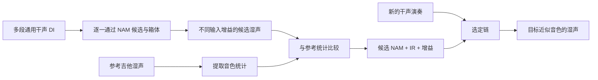

# 当前方案、困难与试听说明

当前采用“已有 NAM 模型检索 + 输入增益搜索 + 可选受限 EQ”。深度学习负责已有 NAM 的音频模拟；自动找哪个音色更合适，目前主要使用信号处理特征和统计距离，没有训练新的音色识别网络，也没有仅凭目标湿声训练出新的 `.nam`。

最终目标仍然是：输入吉他参考湿声，得到能处理新吉他干声的整体音色模型。现阶段的近似交付方向为已有 `.nam`、箱体/校正 IR 和增益设置。新单文件 `.nam` 的训练或蒸馏、实际 NAM_LV2 与 Orange Pi 验证仍未完成。

## 整体处理与辅助研究

原生产基线继承 NAM-EQ-Match 的频谱、动态和失真相关统计。项目随后比较多 DI 汇总、半倍频程平滑谱；它们仍是研究基线，未据小样本更换生产权重。音高/起音分组试图只比较相近音域与发音阶段，减轻演奏内容的干扰。第六、七阶段主要在校准这条辅助分支，它尚未证明能提高最终湿声音色检索成绩。

起音检测只给波形打时间标签。合并一个分析峰不等于从吉他声音中删除一次拨弦。NAM 本身也不需要起音标签才能将干声变成湿声。

## 实际依据的开源项目与论文

| 来源 | 本项目中的角色 |
| --- | --- |
| [SD456/NAM-EQ-Match](https://github.com/SD456/NAM-EQ-Match) | 检索、特征、NAM 后端与匹配 IR 的代码起点。固定上游 `1074151da12654fcf1125ed6443a1e53ea5b973d`，本地已有修复，不能称原版照用。 |
| [Neural Amp Modeler](https://github.com/sdatkinson/neural-amp-modeler) | 实际加载、运行已有神经网络权重；本地为 0.13.0，验证范围限原生 48 kHz WaveNet。 |
| [VoLum](https://github.com/guitarlum/VoLum) | 实际候选音色资源，固定提交 `a0b2f08b6be3fa2f7fdb58543f579d32e0ebe2f3`。10 个 NAM 与两条来源明确的箱体 IR 组成 12 条候选链，资源不是检索算法。 |
| Hinrichs 等，2024，[Blind extraction of guitar effects through blind system inversion and neural guitar effect modeling](https://doi.org/10.1186/s13636-024-00330-0) | 用户提供的原始论文，提供仅湿声盲建模方向。论文结合盲逆系统和神经效果建模；当前检索流程不是该论文的复现。论文所测 phaser、soft clipping、slapback delay，也不等同于任意设备整链已解决。 |
| Mauch 与 Dixon，2014，[pYIN: A fundamental frequency estimator using probabilistic threshold distributions](https://doi.org/10.1109/ICASSP.2014.6853678) | 通过 librosa 的 pYIN 估计音高；128 ms 窗 / 0.8 门槛为本地校准候选，仍有八度与起音覆盖限制。 |
| Kehling 等，DAFx 2014，[Automatic Tablature Transcription of Electric Guitar Recordings by Estimation of Score- and Instrument-related Parameters](https://www.dafx14.fau.de/papers/dafx14_christian_kehling_automatic_tablature_trans.pdf) 与 [IDMT 数据发布](https://www.idmt.fraunhofer.de/en/publications/datasets/guitar.html) | 公开真实 DI 和音高/起音标签，供前端评估；不是我们的音色训练集。 |
| Pedroza 等，ICASSP 2025，[Guitar-TECHS](https://guitar-techs.github.io/) | 真实 DI，用于 NAM 受控渲染与跨演奏检索。本地实际用到的子集与独立性限制见各阶段来源清单。 |

本地当前 CLI 没有把 Demucs 音源分离、CLAP 嵌入或上述论文的盲逆推网络接入检索。最早峰/最强峰比较、多 DI 平滑谱和相关冻结验证是本项目的实验设计，不借论文名义宣称已验证。

## 目前卡在哪里

1. **评分混合了演奏内容与设备音色。** 换音高、乐句或力度，统计谱和动态也会变化。第四阶段多 DI 基线：同一条件下无后 EQ 首选真链 12/16，目标加温和 EQ 后为 4/16，尚不可靠。[记录](stage4-conclusions.md)
2. **源电平与模型前输入增益无法唯一拆开。** 相同总输入可以产生逐样本相同输出。这允许多个等效解，却不允许把搜索档位当作真实硬件旋钮或物理力度。
3. **自动 EQ 可能修正了演奏差异。** 当前自动新增 EQ 保持旁路；扩大 EQ 范围不能修复错误的非线性响应。
4. **前端仍是局部结果。** 音高长窗在所测干净单音上提高覆盖；起音合并将新留出平均 F1 从 0.5335 提高至 0.6717，仍有严格匹配损失，且没有快速同音材料。不能据此证明整体音色更像。[记录](stage7-findings.md)
5. **模型库和验证范围有限。** 12 条链偏过载音色；未完成开放来源、清音、调制/长时间效果、不同用户吉他与实际插件部署验证。

还需要注意评价目标：真链身份命中是诊断工具，用户最终需要的是新 DI 上的音色和响应接近。选错链也可能听起来可接受；局部特征指标改善也可能没有改善声音。后续方向应结合可听的整链输出决定，不能只追求身份命中率或起音 F1。

## 三份可直接播放的对照

本轮只重现第四阶段既有案例，没有重新检索。按原结果顺序选第一个“无附加后 EQ 且首选错误”的案例 `6_0_E0 / T0`。当时检索看到的是录音 04 的参考 T0；以下三份换用同一段录音 05 的 H0 干声，使演奏内容完全相同。H0 已在历史实验中观察，当前不是新确认。

| 文件 | 内容 |
| --- | --- |
| A | Guitar-TECHS 的真实 Sire T7 干声 H0。 |
| B | A 经已知目标 `AMP-Sbgo-1` + BG412S DV77/V30 箱体 IR，输入搜索档 0 dB。 |
| C | A 经旧检索选中的 `G12-2204-3`（已含箱体）及 −7 dB 输入档。 |

两条湿声均用真实 NAM 权重计算，输入均保留 +8.720155 dB 的既有公共校准，无匹配 EQ。试听只在处理完成后按前 8 秒 RMS 对齐音量，保留完整卷积尾部并补齐同长度；没有限幅或压缩。等 RMS 不代表主观响度完全相同。

A：干声

B：已知目标处理后的同一演奏

C：旧检索选中链处理后的同一演奏

也可播放 [A→B→C 连续版](<LOCAL_PROJECT_ROOT>/artifacts/listening-current/00-dry-target-retrieved-sequence.wav)。每段约 9.28 秒，段间有 0.5 秒间隔。

B/C 的历史多尺度谱误差 0.74219、居中长期谱差 2.72314 dB 在本轮精确复现，均未过原有筛选线。这不是主观盲听结果。可重点比较相同拨弦处的失真质感、明暗、起音和延音；最终以用户听感与弹奏可用性判断，而非这些数字代替听觉。

## 可选：把起音标签听出来

三份诊断音频均保持同一段 LP_Lick6 干声在左声道，仅在右声道加标记点击；左声道逐样本一致。点击不属于吉他音色，不是效果器产生的声音。

- [原标签点击](<LOCAL_PROJECT_ROOT>/artifacts/listening-current/04-onsets-label.wav)
- [未合并检测点击](<LOCAL_PROJECT_ROOT>/artifacts/listening-current/05-onsets-raw.wav)
- [最早峰 / 80 ms 点击](<LOCAL_PROJECT_ROOT>/artifacts/listening-current/06-onsets-first80.wav)

这些文件只把旧检测结果声化，没有改算法或重新检测。请将“标签是否多报”与“B/C 音色是否接近”作为两个独立判断。

## 可复核记录

生成脚本 `scripts/make_listening_pack.py`；格式、源文件/权重/IR 哈希、输入与试听输出增益、尾部长度在 `artifacts/listening-current/manifest.json`。6 份单独试听通过有限值、峰值、写盘读回和相同干声检查；真实 NAM 的旧误差指标逐值复现。466 项历史文件和当前冻结来源/主结果摘要保持不变。未做主观音质判断、盲听、新湿声建模或 Free Bird 匹配。
