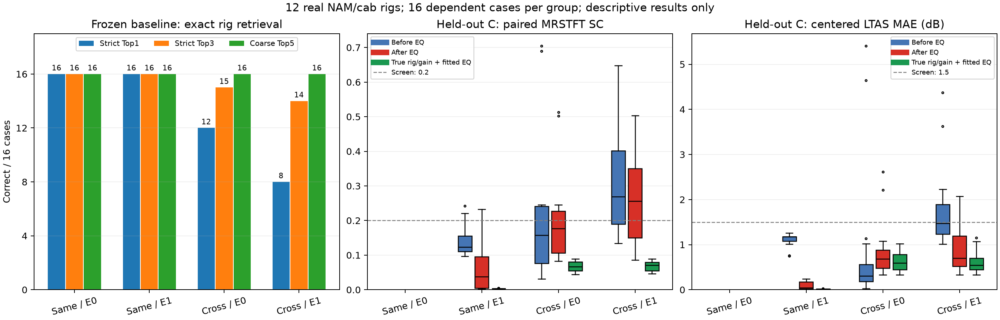

# 第二阶段真实 NAM 检索结果

本报告由 `scripts/stage2_analyze.py` 从冻结正式运行独立复算。仅使用 `artifacts/stage2/real_fp64`；早期 float32 校准运行在生产一致性检查处失败，其 partial cache 不进入统计。

12 条真实链（10 个 NAM，其中两个另配一条箱体），4 条目标链 × 2 档真增益 × A/B 两个目标乐句 × 同/跨 DI × E0/E1 = 64 例。六种预声明评分共 384 行；4 例生产搜索直接核对全部通过。A/B/C 来自同一吉他、同一录音 session，各 8 秒；每格 16 例相互依赖，不能当作 16 个独立设备或独立演奏者。

## 冻结基线

| 分组 | Exact Top1 | Exact Top3 | Coarse Top5 | 全扫 Top1 | 全扫 Top3 | NAM Top1 | Family Top1 |
|---|---:|---:|---:|---:|---:|---:|---:|
| same_noeq | 16/16 | 16/16 | 16/16 | 16/16 | 16/16 | 16/16 | 16/16 |
| same_eq | 16/16 | 16/16 | 16/16 | 16/16 | 16/16 | 16/16 | 16/16 |
| cross_noeq | 12/16 | 15/16 | 16/16 | 12/16 | 15/16 | 12/16 | 12/16 |
| cross_eq | 8/16 | 14/16 | 16/16 | 8/16 | 14/16 | 8/16 | 8/16 |

同 DI/E0 工程门槛 16/16：通过。跨 DI/E0 内部门槛：通过；跨 DI/E1：未通过。跨 DI 每格门槛固定为 Top1 ≥12/16、Top3 ≥14/16、coarse Top5 =16/16，未因结果放宽。随机排列参照分别为 1/12、3/12、5/12。

## 数字增益

误差均是公共 A 校准参考系下的 nominal dB，不能解释成物理驱动量恢复准确率。

| 分组 | 选对完整链的分母 | 选对链时增益绝对误差中位数 dB | 强制真链误差中位数 dB（n=16） | 强制真链误差≤1 dB |
|---|---:|---:|---:|---:|
| same_noeq | 16/16 | 0.0 | 0.00 | 16/16 |
| same_eq | 16/16 | 1.0 | 1.00 | 9/16 |
| cross_noeq | 12/16 | 3.5 | 4.50 | 2/16 |
| cross_eq | 8/16 | 4.5 | 4.50 | 3/16 |

## 留出 C 的同输入配对评价

C 完全排除在检索、特征缓存与 EQ 拟合之外。每例把同一段 C 分别送入选中链和真链，尾长补零至两者较长长度；只为评价以整段 RMS 标量对齐候选输出。MRSTFT SC 用 512/2048/8192 点窗、75% overlap 的三个幅度谱收敛度平均；LTAS 在 80–8000 Hz 对数频点上去掉差值中位数后计算 MAE。下表连续值为每格16例的中位数；筛选计数要求 SC≤0.20 且 LTAS≤1.5 dB。这是客观内部筛选，不是听感等价证明。

| 分组 | 版本 | SC 中位数 | LTAS MAE dB | 过筛选 |
|---|---|---:|---:|---:|
| same_noeq | 选中链，校正前 | 0.0000 | 0.000 | 16/16 |
| same_noeq | 选中链，校正后 | 0.0000 | 0.000 | 16/16 |
| same_noeq | 已知真链真增益，校正前 | 0.0000 | 0.000 | 16/16 |
| same_noeq | 已知真链真增益，拟合EQ后 | 0.0000 | 0.000 | 16/16 |
| same_eq | 选中链，校正前 | 0.1230 | 1.174 | 14/16 |
| same_eq | 选中链，校正后 | 0.0376 | 0.045 | 14/16 |
| same_eq | 已知真链真增益，校正前 | 0.1164 | 1.175 | 16/16 |
| same_eq | 已知真链真增益，拟合EQ后 | 0.0031 | 0.015 | 16/16 |
| cross_noeq | 选中链，校正前 | 0.1579 | 0.307 | 10/16 |
| cross_noeq | 选中链，校正后 | 0.1765 | 0.681 | 9/16 |
| cross_noeq | 已知真链真增益，校正前 | 0.0000 | 0.000 | 16/16 |
| cross_noeq | 已知真链真增益，拟合EQ后 | 0.0664 | 0.591 | 16/16 |
| cross_eq | 选中链，校正前 | 0.2684 | 1.475 | 5/16 |
| cross_eq | 选中链，校正后 | 0.2557 | 0.702 | 6/16 |
| cross_eq | 已知真链真增益，校正前 | 0.1164 | 1.175 | 16/16 |
| cross_eq | 已知真链真增益，拟合EQ后 | 0.0711 | 0.543 | 16/16 |

已知真链真增益的拟合 EQ 参照也使用各例相同的目标/搜索演奏，在跨 DI 时仍面对跨演奏拟合的混杂；它不是把已知 E1 直接倒置。因此链身份失败和 C 上功能不接近需分别判断；真链参照若经拟合也恶化，说明误差不能全部归咎于链检索。每例前后差与分布保留在 analysis.json。

## 固定增益特征诊断

使用缓存中全部12条链 × A/B × 0/+6 dB共48个指纹。固定增益比较同链换DI（每档24个有向配对）和同DI换链（每档264个有向配对）；两方向都计入，避免把按目标范数归一化的MFCC距离误当作对称距离。下表为分项已加权总分的均值（含0.25 EQ惩罚），并非增益搜索后的最小分。

| 增益 dB | 同链换DI | 同DI换链 |
|---|---:|---:|
| 0 | 1.0749 | 2.8813 |
| 6 | 1.0739 | 2.8125 |

各评分分项的已加权均值如下；有向距离只作描述，不把大量共享指纹的配对当作独立样本。

| 分项 | g0 同链换DI | g0 同DI换链 | g6 同链换DI | g6 同DI换链 |
|---|---:|---:|---:|---:|
| crest | 0.0587 | 0.2389 | 0.0568 | 0.2596 |
| kurtosis | 0.2798 | 0.7812 | 0.3301 | 0.7652 |
| peak_density | 0.0588 | 0.1898 | 0.0651 | 0.2209 |
| hf_ratio | 0.2454 | 0.4711 | 0.2040 | 0.4687 |
| spec_crest_hf | 0.0891 | 0.3743 | 0.1070 | 0.3274 |
| dyn_range | 0.0409 | 0.3073 | 0.0278 | 0.2930 |
| sustain | 0.0140 | 0.0402 | 0.0119 | 0.0329 |
| flux | 0.0183 | 0.0418 | 0.0181 | 0.0375 |
| mfcc_texture | 0.1360 | 0.1974 | 0.1319 | 0.1720 |
| mfcc_delta | 0.0393 | 0.0580 | 0.0374 | 0.0600 |
| drive_gap | 0.0811 | 0.1201 | 0.0708 | 0.1195 |
| weighted_eq | 0.0136 | 0.0613 | 0.0131 | 0.0559 |

distortion_index 各输入分量达到上限clip的比例：crest 15/48 (31.2%)、kurtosis 12/48 (25.0%)、peak_density 5/48 (10.4%)、hf_ratio 14/48 (29.2%)。分项均值、低端clip计数及index分布见 analysis.json；局部分量饱和不等于整个index恒定，也不证明所有指纹失去辨别力。

## 失败与预声明消融

| 方法 | same/E0 Top1 | same/E1 Top1 | cross/E0 Top1 | cross/E1 Top1 |
|---|---:|---:|---:|---:|
| baseline | 16/16 | 16/16 | 12/16 | 8/16 |
| no_drive_gap | 16/16 | 16/16 | 12/16 | 8/16 |
| no_hf_terms | 16/16 | 15/16 | 14/16 | 8/16 |
| no_dynamic_texture | 16/16 | 8/16 | 12/16 | 6/16 |
| no_eq_penalty | 16/16 | 15/16 | 12/16 | 7/16 |
| eq_only | 16/16 | 16/16 | 13/16 | 13/16 |

基线错误的诊断计数：scoring_prefers_other_rig=12。全扫仍偏爱错链归入scoring；全扫找回但粗排漏掉归入coarse_pruning；全扫找回、粗排入围但最终错选归入local_gain_refinement。最后一类也可能是竞争链局部区间改变相对名次；分类只定位两阶段与全扫的差异，不证明单一因果。

逐例winner/truth、真档/强制真链最佳档、相对两种真链档位的分项差及Top2间距保存在 analysis.json。下表列前8个基线错误（按冻结运行顺序），不是按严重度筛选。

| case | 真链 | winner | 真增益 / winner / 强制真链最佳 dB | 诊断 |
|---|---|---|---|---|
| 6_0_A_B_E0 | AMP-Sbgo-1@bg412s-godmode-dv77-v30-mix | AMP-SLO1-1@bg412s-godmode-dv77-v30-mix | 0 / 10.0 / 7.0 | scoring_prefers_other_rig |
| 6_0_A_B_E1 | AMP-Sbgo-1@bg412s-godmode-dv77-v30-mix | AMP-SLO1-1@bg412s-godmode-dv77-v30-mix | 0 / 10.0 / 7.0 | scoring_prefers_other_rig |
| 6_0_B_A_E0 | AMP-Sbgo-1@bg412s-godmode-dv77-v30-mix | AMP-2204-1@bg412s-godmode-dv77-v30-mix | 0 / -5.0 / -2.0 | scoring_prefers_other_rig |
| 6_0_B_A_E1 | AMP-Sbgo-1@bg412s-godmode-dv77-v30-mix | AMP-2204-1@bg412s-godmode-dv77-v30-mix | 0 / -3.0 / -3.0 | scoring_prefers_other_rig |
| 6_6_A_B_E0 | AMP-Sbgo-1@bg412s-godmode-dv77-v30-mix | AMP-SLO1-1@bg412s-godmode-dv77-v30-mix | 6 / 12.0 / 11.0 | scoring_prefers_other_rig |
| 6_6_A_B_E1 | AMP-Sbgo-1@bg412s-godmode-dv77-v30-mix | AMP-OD12-1@bg412s-godmode-dv77-v30-mix | 6 / -2.0 / 11.0 | scoring_prefers_other_rig |
| 6_6_B_A_E0 | AMP-Sbgo-1@bg412s-godmode-dv77-v30-mix | AMP-2204-1@bg412s-godmode-dv77-v30-mix | 6 / -2.0 / 1.0 | scoring_prefers_other_rig |
| 6_6_B_A_E1 | AMP-Sbgo-1@bg412s-godmode-dv77-v30-mix | AMP-2204-1@bg412s-godmode-dv77-v30-mix | 6 / 1.0 / 2.0 | scoring_prefers_other_rig |

no_drive_gap去掉方向性驱动项；no_hf_terms仅去掉显式hf_ratio/spec_crest_hf，保留的drive_gap仍含HF；no_dynamic_texture去掉dyn_range/sustain/flux/mfcc_texture/mfcc_delta；no_eq_penalty去掉0.25 EQ项；eq_only仅保留该EQ项。五项消融均重新排序候选和增益，仅供解释，未据此改权重或自动替换生产基线。

## 与旧合成反事实的关系及范围

旧2×2 MockAmp诊断独立保存在toy-ablation.json：

- same / E0：有效drive误差 0.2233 dB，分数 0.022519。
- cross / E0：有效drive误差 7.7767 dB，分数 1.271562。
- same / E1：有效drive误差 12.7767 dB，分数 0.665512。
- cross / E1：有效drive误差 13.7767 dB，分数 1.181912。

旧四格是在不同名义模型可通过输入增益互相等效的tanh族上观察演奏/EQ混杂，不混入真实NAM分母。真实库没有把不同NAM的名义增益直接相加。

本次只覆盖一把吉他同次录音、四条目标链、两个真增益与一个固定后级高架EQ；C也来自同次录音。未测试开放库未知目标、其他乐手/拾音器/硬件输入增益、歌曲分离、Free Bird或插件/板端回放。任何格通过内部阈值都不能证明通用音色识别成功；最终听感仍需独立主观评价。未根据本次结果调参。

复算命令：`.venv/Scripts/python.exe scripts/stage2_analyze.py`。独立汇总断言、384行/64case/64配对/4一致性断言及缓存身份断言均通过后才输出本报告。
