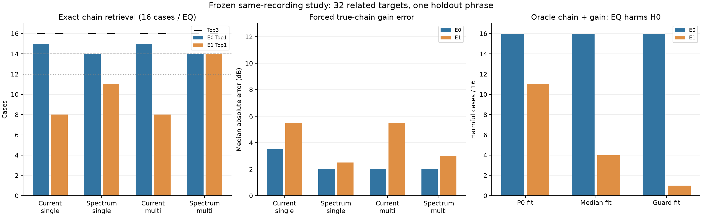

# 第三阶段结果：多探针、增益漂移与错误 EQ

本轮为同一次录音的 32 个相关目标（E0/E1 各 16），四种方法在同一案例上配对；仅 H0 一个新留出乐句。P0–P2、R0/R1、H0 与旧 A/B/C 均无样本重叠，但不能据此声称跨录音、吉他或乐手泛化。Free Bird 仍暂停，生产参数与第二阶段基线未改。

本轮两类评分的多探针均未达到联合改进门槛。既有评分在 E0 的强制真链增益误差中位数由 3.5 降至 2.0 dB；平滑谱在 E1 的 Top1 由 11/16 升至 14/16、直通过筛由 9/16 升至 13/16，但增益误差中位数由 2.5 变为 3.0 dB。链身份、驱动档与留出误差需要分别评价。

错误 EQ 仍未解决：E0 已知真链、真增益时，单段／中位数／门控校正分别使 16/16、16/16、16/16 例实质恶化；后两者却都保持 16/16、16/16 过筛。门控减小错误校正幅度，不能据过筛数认定无害。

## 检索与数字增益

|方法|EQ|Top1|Top3|强制真链增益绝对误差中位数 dB|近优集合覆盖真档|集合大小/宽度中位数|胜者/真链边界数|
|---|---|---|---|---|---|---|---|
|current_single|E0|15/16|16/16|3.50|4/16|3 档 / 2 dB|0/16 / 0/16|
|current_single|E1|8/16|16/16|5.50|3/16|4 档 / 3 dB|2/16 / 0/16|
|spectrum_single|E0|14/16|16/16|2.00|9/16|6.5 档 / 5.5 dB|1/16 / 0/16|
|spectrum_single|E1|11/16|16/16|2.50|9/16|6 档 / 5 dB|0/16 / 0/16|
|current_multi|E0|15/16|16/16|2.00|10/16|3.5 档 / 2.5 dB|1/16 / 0/16|
|current_multi|E1|8/16|16/16|5.50|3/16|4 档 / 3 dB|5/16 / 2/16|
|spectrum_multi|E0|14/16|16/16|2.00|10/16|7 档 / 6 dB|1/16 / 0/16|
|spectrum_multi|E1|14/16|16/16|3.00|7/16|5.5 档 / 4.5 dB|1/16 / 1/16|

近优集合按最低分加全曲线跨度的 5% 保留，平坦曲线全保留；允许不连通集合，它不是概率置信区间。错链增益只具名义意义，增益准确度以强制真链的全部 16 例为主。

- current 多探针联合改进：未达到冻结门槛。
  E0：Top1 变化 +0/16，Top3 +0/16；增益误差中位数降低 1.50 dB；H0 直通过筛数变化 +0/16。检索绝对门槛通过。
  E1：Top1 变化 +0/16，Top3 +0/16；增益误差中位数降低 0.00 dB；H0 直通过筛数变化 +1/16。检索绝对门槛未通过。
- spectrum 多探针联合改进：未达到冻结门槛。
  E0：Top1 变化 +0/16，Top3 +0/16；增益误差中位数降低 0.00 dB；H0 直通过筛数变化 +1/16。检索绝对门槛通过。
  E1：Top1 变化 +3/16，Top3 +0/16；增益误差中位数降低 -0.50 dB；H0 直通过筛数变化 +4/16。检索绝对门槛通过。

联合门槛要求 E0/E1 均 Top1 ≥12/16、Top3 ≥14/16；各自增益误差中位数比同类单探针降低至少 1 dB，且 H0 直通过筛数均不下降。分项变化不等于联合获胜。

## H0 校正：与同例直通配对

|方法|EQ|方案|SC中位数|LTAS中位数 dB|过筛|恶化|改善|失守|双向越界|
|---|---|---|---|---|---|---|---|---|---|
|current_single|E0|bypass|0.1042|0.275|15/16|0/16|0/16|0/16|0/16|
|current_single|E0|single_fit|0.1992|1.196|7/16|16/16|1/16|8/16|1/16|
|current_single|E0|median_fit|0.1453|0.712|15/16|12/16|1/16|0/16|0/16|
|current_single|E0|guard_fit|0.1068|0.458|15/16|4/16|1/16|0/16|0/16|
|current_single|E1|bypass|0.3486|2.219|4/16|0/16|0/16|0/16|0/16|
|current_single|E1|single_fit|0.3611|1.683|4/16|7/16|12/16|2/16|3/16|
|current_single|E1|median_fit|0.3404|1.491|7/16|3/16|15/16|0/16|2/16|
|current_single|E1|guard_fit|0.3362|1.573|8/16|1/16|14/16|0/16|0/16|
|spectrum_single|E0|bypass|0.0825|0.179|13/16|0/16|0/16|0/16|0/16|
|spectrum_single|E0|single_fit|0.2454|1.239|6/16|16/16|0/16|7/16|0/16|
|spectrum_single|E0|median_fit|0.1372|0.718|13/16|14/16|0/16|0/16|0/16|
|spectrum_single|E0|guard_fit|0.0897|0.352|13/16|7/16|0/16|0/16|0/16|
|spectrum_single|E1|bypass|0.1549|1.194|9/16|0/16|0/16|0/16|0/16|
|spectrum_single|E1|single_fit|0.2018|1.419|8/16|12/16|8/16|3/16|4/16|
|spectrum_single|E1|median_fit|0.1390|1.030|11/16|3/16|13/16|0/16|1/16|
|spectrum_single|E1|guard_fit|0.1255|0.954|11/16|1/16|13/16|0/16|1/16|
|current_multi|E0|bypass|0.0653|0.202|15/16|0/16|0/16|0/16|0/16|
|current_multi|E0|single_fit|0.2266|1.123|7/16|15/16|1/16|8/16|0/16|
|current_multi|E0|median_fit|0.1256|0.675|14/16|14/16|1/16|1/16|0/16|
|current_multi|E0|guard_fit|0.0779|0.368|15/16|6/16|1/16|0/16|0/16|
|current_multi|E1|bypass|0.2519|1.532|5/16|0/16|0/16|0/16|0/16|
|current_multi|E1|single_fit|0.2771|1.506|5/16|6/16|9/16|1/16|1/16|
|current_multi|E1|median_fit|0.2401|1.088|6/16|3/16|14/16|0/16|1/16|
|current_multi|E1|guard_fit|0.2325|1.166|7/16|1/16|13/16|0/16|0/16|
|spectrum_multi|E0|bypass|0.0583|0.116|14/16|0/16|0/16|0/16|0/16|
|spectrum_multi|E0|single_fit|0.2338|1.189|7/16|16/16|0/16|7/16|0/16|
|spectrum_multi|E0|median_fit|0.1333|0.718|14/16|15/16|0/16|0/16|0/16|
|spectrum_multi|E0|guard_fit|0.0769|0.333|14/16|9/16|0/16|0/16|0/16|
|spectrum_multi|E1|bypass|0.1520|1.143|13/16|0/16|0/16|0/16|0/16|
|spectrum_multi|E1|single_fit|0.2003|1.135|8/16|12/16|8/16|6/16|4/16|
|spectrum_multi|E1|median_fit|0.1512|0.705|13/16|5/16|12/16|1/16|2/16|
|spectrum_multi|E1|guard_fit|0.1346|0.702|14/16|0/16|12/16|0/16|0/16|

过筛为 SC ≤0.20 且 LTAS ≤1.5 dB；恶化为相对直通 ΔSC >0.02 或 ΔLTAS >0.25 dB，改善按对称负阈值判定。两指标同时反向越界时可同时计改善与恶化，双向越界单列。失守指直通过筛而校正后失败。

## 已知真链与真增益：凭空校正与真实 EQ 拒绝

|EQ|方案|SC中位数|LTAS中位数 dB|过筛|恶化|改善|实际80–8000Hz平均绝对EQ中位数 dB|
|---|---|---|---|---|---|---|---|
|E0|bypass|0.0000|0.000|16/16|0/16|0/16|0.000|
|E0|single_fit|0.1760|1.126|8/16|16/16|0/16|0.597|
|E0|median_fit|0.0953|0.667|16/16|16/16|0/16|0.468|
|E0|guard_fit|0.0374|0.262|16/16|16/16|0/16|0.059|
|E1|bypass|0.0851|1.175|16/16|0/16|0/16|0.000|
|E1|single_fit|0.1520|1.044|13/16|11/16|5/16|1.269|
|E1|median_fit|0.0882|0.660|16/16|4/16|13/16|1.131|
|E1|guard_fit|0.0796|0.747|16/16|1/16|13/16|0.914|

E0 已知真链、真增益的直通两项误差经断言为数值零附近，因而仅看校正后是否过筛会漏掉凭空引入的误差。上表同时报告恶化比例与实际 FIR 频响强度。
E0：中位数方案改善但 guard 无实质改善 0/16；中位数过筛但 guard 失败 0/16；guard 的 SC/LTAS 高于中位数方案分别 0/16、0/16。E1 的这些量用于检查保守门控是否丢失真实 EQ 的校正机会；它们不等同于逐频真 EQ 识别率。
E1：中位数方案改善但 guard 无实质改善 1/16；中位数过筛但 guard 失败 0/16；guard 的 SC/LTAS 高于中位数方案分别 7/16、10/16。E1 的这些量用于检查保守门控是否丢失真实 EQ 的校正机会；它们不等同于逐频真 EQ 识别率。

median_fit 和 guard_fit 使用相同额外半倍频程平滑，仅门控不同；single_fit 沿用旧 P0 算法，因此与 median_fit 的差异包含探针数和额外平滑，不能只归因探针数。

## 参考乐句、教师分层与漂移

|方法|EQ|分层|Top1|Top3|强制真链增益误差中位数 dB|
|---|---|---|---|---|---|
|current_single|E0|R0|7/8|8/8|3.50|
|current_single|E0|R1|8/8|8/8|4.00|
|current_single|E0|AMP-2204-1@bg412s-godmode-dv77-v30-mix|4/4|4/4|3.50|
|current_single|E0|G12-2204-3|4/4|4/4|7.00|
|current_single|E0|AMP-Sbgo-1@bg412s-godmode-dv77-v30-mix|3/4|4/4|2.00|
|current_single|E0|V30-SLO1-3|4/4|4/4|4.00|
|current_single|E1|R0|4/8|8/8|4.00|
|current_single|E1|R1|4/8|8/8|6.50|
|current_single|E1|AMP-2204-1@bg412s-godmode-dv77-v30-mix|4/4|4/4|6.00|
|current_single|E1|G12-2204-3|0/4|4/4|11.50|
|current_single|E1|AMP-Sbgo-1@bg412s-godmode-dv77-v30-mix|4/4|4/4|1.00|
|current_single|E1|V30-SLO1-3|0/4|4/4|2.00|
|spectrum_single|E0|R0|6/8|8/8|1.50|
|spectrum_single|E0|R1|8/8|8/8|3.50|
|spectrum_single|E0|AMP-2204-1@bg412s-godmode-dv77-v30-mix|4/4|4/4|1.50|
|spectrum_single|E0|G12-2204-3|4/4|4/4|1.00|
|spectrum_single|E0|AMP-Sbgo-1@bg412s-godmode-dv77-v30-mix|2/4|4/4|4.50|
|spectrum_single|E0|V30-SLO1-3|4/4|4/4|3.00|
|spectrum_single|E1|R0|5/8|8/8|3.00|
|spectrum_single|E1|R1|6/8|8/8|2.00|
|spectrum_single|E1|AMP-2204-1@bg412s-godmode-dv77-v30-mix|4/4|4/4|3.00|
|spectrum_single|E1|G12-2204-3|3/4|4/4|3.00|
|spectrum_single|E1|AMP-Sbgo-1@bg412s-godmode-dv77-v30-mix|4/4|4/4|2.50|
|spectrum_single|E1|V30-SLO1-3|0/4|4/4|3.00|
|current_multi|E0|R0|8/8|8/8|1.50|
|current_multi|E0|R1|7/8|8/8|2.50|
|current_multi|E0|AMP-2204-1@bg412s-godmode-dv77-v30-mix|4/4|4/4|2.50|
|current_multi|E0|G12-2204-3|4/4|4/4|6.00|
|current_multi|E0|AMP-Sbgo-1@bg412s-godmode-dv77-v30-mix|3/4|4/4|1.00|
|current_multi|E0|V30-SLO1-3|4/4|4/4|1.00|
|current_multi|E1|R0|4/8|8/8|4.00|
|current_multi|E1|R1|4/8|8/8|6.50|
|current_multi|E1|AMP-2204-1@bg412s-godmode-dv77-v30-mix|4/4|4/4|5.50|
|current_multi|E1|G12-2204-3|0/4|4/4|11.50|
|current_multi|E1|AMP-Sbgo-1@bg412s-godmode-dv77-v30-mix|3/4|4/4|1.00|
|current_multi|E1|V30-SLO1-3|1/4|4/4|2.00|
|spectrum_multi|E0|R0|6/8|8/8|1.50|
|spectrum_multi|E0|R1|8/8|8/8|2.00|
|spectrum_multi|E0|AMP-2204-1@bg412s-godmode-dv77-v30-mix|4/4|4/4|0.50|
|spectrum_multi|E0|G12-2204-3|4/4|4/4|1.00|
|spectrum_multi|E0|AMP-Sbgo-1@bg412s-godmode-dv77-v30-mix|2/4|4/4|3.00|
|spectrum_multi|E0|V30-SLO1-3|4/4|4/4|3.00|
|spectrum_multi|E1|R0|6/8|8/8|3.00|
|spectrum_multi|E1|R1|8/8|8/8|3.00|
|spectrum_multi|E1|AMP-2204-1@bg412s-godmode-dv77-v30-mix|4/4|4/4|3.00|
|spectrum_multi|E1|G12-2204-3|4/4|4/4|1.50|
|spectrum_multi|E1|AMP-Sbgo-1@bg412s-godmode-dv77-v30-mix|4/4|4/4|3.50|
|spectrum_multi|E1|V30-SLO1-3|2/4|4/4|3.00|

current_single：R0→R1 真链最佳档绝对变化中位数 2.00 dB（16 对）；E0→E1 为 3.50 dB（16 对）。逐对有符号差保存在 analysis.json。

spectrum_single：R0→R1 真链最佳档绝对变化中位数 2.50 dB（16 对）；E0→E1 为 3.50 dB（16 对）。逐对有符号差保存在 analysis.json。

current_multi：R0→R1 真链最佳档绝对变化中位数 2.50 dB（16 对）；E0→E1 为 5.50 dB（16 对）。逐对有符号差保存在 analysis.json。

spectrum_multi：R0→R1 真链最佳档绝对变化中位数 2.00 dB（16 对）；E0→E1 为 4.00 dB（16 对）。逐对有符号差保存在 analysis.json。

## 复核、产物与限制

结果 SHA-256：`ccc80516ed31c5a19933f8a82970777085de232be0dbf32db1bb51d4bc505c1b`。检索 128 行的全部 12×25 分数、排名、档位、Top1/Top3、名义误差、边界与近优集合均独立复算；H0 与 oracle 的派生阈值、同设置同结果和 E0 自对照均验证。评分直连保真检查 4/4。聚合分数复核：`recomputed_all_128_grids_from_900_probe_features_and_32_targets`。

基线与冻结源文件 SHA-256 逐项比对见 analysis.json。候选缓存必须恰为 900 个 P 探针条目，不含 R/H。原始结果保留逐例 SC/LTAS、增量与实际滤波器强度；此后处理不重新渲染音频，因此两项音频指标仅复核派生计算与自一致性。

第二阶段与本轮参考／探针数据不同，不能把跨阶段数字差异归因算法。本轮结论限于四方法同案例配对；单一录音、封闭候选库、共享教师与 H0，禁止将 32 例视为独立抽样或推断生产可用性。

