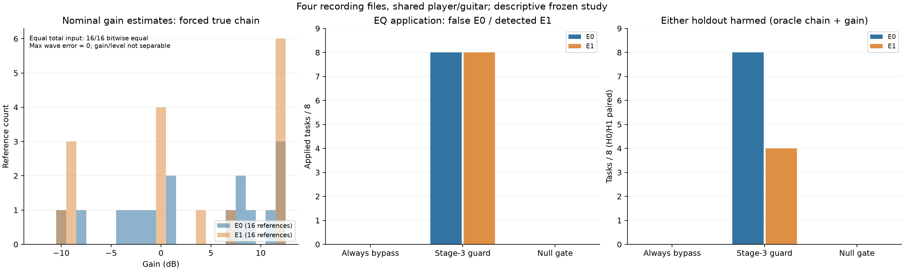

# 第四阶段结果：增益不可辨识与跨录音乐句的 EQ 判定

冻结研究门槛未通过。经验零假设阈值 Q = 22.812773 dB，来自非教师 8 条候选、2 档增益、C0/C1 的 32 条不限幅校准曲线。E0 错加 EQ 0/8、任一留出受损 0/8；E1 启用 0/8、两段均改善且无害 0/8。冻结条件为依次 ≤1、≤1、≥6、≥6；没有根据结果重选参数。

所选链 EQ 状态：`not_validated_oracle_gate_failed`。门槛失败，部署组未验证；本批真实 E1 检出率为 0/8，全部拒绝。零误加来自全旁路，不能据此认定 EQ 问题解决。

## 增益与原始输入电平

48 次实际两处数字缩放渲染组成 16 对等总输入反例：16/16 逐样本完全相等，最大波形误差 0。在固定 NAM 之前的两个数字输入 trim 位置，湿声只能约束有效增益 g+l，原始 NAM 输入增益与数字输入电平结构上不可辨识；这不证明所有实体音箱 Gain 旋钮都等价于该数字缩放。真实拨弦强弱还会改变频谱、起音与包络，并非纯电平缩放；没有力度标签，本轮未验证真实拨弦力度分离。

反事实在数字电平 ±6 dB 假设下的原始档集合覆盖 48/48，集合跨度中位数 12 dB；已知数字电平的减法 oracle 只验证代数。以下跨录音结果对合成器名义档评分，集合没有概率覆盖保证。

|条件|Top1|Top3|强制真链误差中位数 dB|近优覆盖|近优跨度中位数 dB|近优并集兼容覆盖|并集跨度中位数 dB|两 H 直通过筛|
|---|---|---|---|---|---|---|---|---|
|E0|12/16|12/16|7.5|4/16|5|12/16|14.5|9/16|
|E1|4/16|11/16|6|4/16|7|12/16|14|4/16|

近优集合沿用分数跨度的 5%，跨度 <10⁻⁹ 时全保留；上表兼容集合为每个近优有效档对应 ±6 dB 原始档集合的并集，再与 −12…+12 dB 格点相交，可能比单点 e±6 更宽。两种集合均非置信区间。32 行完整 12×25 分数均从 900 项 P-only 谱缓存及保存的目标谱独立重算，逐探针居中频带 MAE 后取三探针中位数。

单点估计的兼容集合另列如下：只用一个估计有效档 e，计算 [e−6,e+6] 与搜索格点的交集。优先解释强制正确链；winner 若选中错误 NAM，其增益档不能与真 NAM 跨模型比较物理参数，该列覆盖只作合成器名义诊断。

|条件|单点来源|真名义档覆盖|集合档数中位数|跨度中位数 dB|
|---|---|---|---|---|
|E0|强制正确链|7/16|11|10|
|E0|检索 winner（仅名义诊断）|5/16|12|11|
|E1|强制正确链|9/16|10|9|
|E1|检索 winner（仅名义诊断）|7/16|7|6|

Q 的最大值来自 rig 7、g=0 dB、C1 在 116.584 Hz 的原始校准修正 -22.812773 dB。这是跨所有校准曲线的最坏单频点幅度，不代表整个频带或全部曲线存在 22.8 dB 偏差。

## 真链与真增益的 EQ 对照

|条件|方法|启用|拒绝|两 H 均过筛|任一 H 受损|两 H 各有改善且无害|SC 中位数|LTAS 中位数 dB|
|---|---|---|---|---|---|---|---|---|
|E0|bypass|0/8|8/8|8/8|0/8|0/8|0.00000|0.0000|
|E0|stage3_guard|8/8|0/8|5/8|8/8|0/8|0.19390|0.9012|
|E0|null_gate|0/8|8/8|8/8|0/8|0/8|0.00000|0.0000|
|E1|bypass|0/8|8/8|8/8|0/8|0/8|0.09921|1.1751|
|E1|stage3_guard|8/8|0/8|8/8|4/8|2/8|0.15800|1.1316|
|E1|null_gate|0/8|8/8|8/8|0/8|0/8|0.09921|1.1751|

每条件 8 个两参考任务，H0/H1 是同一任务的两段留出，不能算 16 个独立实验。过筛为 SC ≤0.20 且居中 LTAS ≤1.5 dB；受损为同例 ΔSC >0.02 或 ΔLTAS >0.25 dB；实质改善要求至少一项严格低于对应负阈值，且另一项无受损。始终旁路可无害，却不能改善 E1，故不算成功。两 H 过筛与改善无害是不同统计。

旧 guard 沿用 T0 单参考；新规则同时要求 T0/T1 原始曲线同号、最小绝对值 >max(Q,1 dB)、极差 ≤3 dB，支持后才平滑并限制 FIR 响应。Q 不含 T/H；本分析从保存的原始曲线复核判决，未拿旧限幅曲线代替。

## 数字电平与参考漂移

|片段|角色|原始 RMS dBFS|统一校准后 RMS dBFS|峰均比 dB|
|---|---|---|---|---|
|P0|probe|-22.776|-14.056|12.199|
|P1|probe|-21.003|-12.283|12.641|
|P2|probe|-19.279|-10.559|12.982|
|C0|calibration_reference|-24.816|-16.096|13.302|
|C1|calibration_reference|-24.909|-16.189|14.722|
|T0|test_reference|-24.531|-15.811|12.316|
|T1|test_reference|-24.810|-16.090|13.331|
|H0|holdout|-25.840|-17.119|16.690|
|H1|holdout|-27.273|-18.553|16.423|

calibration_reference 平均片段 RMS dBFS 相对 P 组为 -3.843 dB。

test_reference 平均片段 RMS dBFS 相对 P 组为 -3.652 dB。

holdout 平均片段 RMS dBFS 相对 P 组为 -5.537 dB。

T0→T1 强制真链估计档的绝对变化中位数为 1 dB（16 对相关条件，逐对值存 analysis.json）。录音的电平、频谱及音符内容差异可解释候选增益漂移的可能来源，单凭 RMS 不能识别原因或换算真实力度。

## 复核与适用范围

原始独立结果 SHA-256：`877a7e61c560613127f14cfe241b8df87162752e2bbd5280a307672d07482852`。分析代码 SHA-256、缓存及反事实结果 SHA-256、逐项源文件/全部素材/受保护基线哈希、32 条 null 的 Q、16 次 raw 判决、9600 个检索分数、排名/近优集合与停止门槛均保存在 analysis.json。破坏性自检拒绝项：`q, nullcurve, rawcurve, rawdecision, rank, gate, score, paired_delta`。

本后处理只读 JSON 与已存探针谱，未重新渲染湿声；留出 SC/LTAS 只复核保存值的派生阈值和旁路配对一致性，保存的 FIR 另用 FFT 复核全频 ±4.5 dB 限幅。逐例检索和 oracle/H0/H1 指标保存在 analysis.json 及原始 results.json。

四个新文件分别分配探针、校准、目标与留出，支持跨文件乐句检查；同一乐手、Sire 吉他与接口，不能据此证明跨采集 session、乐手、设备或模型家族泛化。教师与非教师候选可能共享 NAM/箱体，目标和留出也被重复用于多个相关任务。源端 ADC/采集增益及真实力度标签未知；RMS 仅描述数字电平，没有实现原始力度/增益分离。

官方目录与严格 TLS 复核、ZIP CRC 证据见 assets/stage4/di/transport-verification.json；原始下载曾降级证书验证，CRC 不提供密码学完整性，官方全包 MD5 未验证。来源和方法限制均保留。生产控制器、阈值与阶段二/三结果保持原样，Free Bird 未开始。

