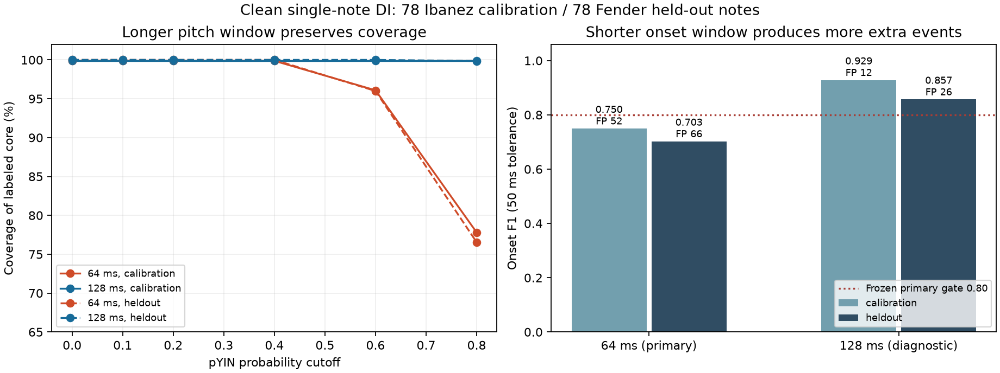

# 第六阶段：带标注单音 DI 的前端校准

已完成公开数据收集、首跑前冻结、校准选择、不同吉他留出评估及独立复核。**128 ms 音高窗能大幅改善当前 0.8 门槛的低音覆盖；64 ms 起音窗的多报仍未达标，保留旧基线，不进入湿声检索。**

## 数据、许可与角色

采用 [IDMT-SMT-Guitar](https://zenodo.org/records/7544110) 原压缩包实际 `dataset1` 的单音目录。作者随包说明确认电吉他直接接音频接口；原网页与随包说明的子集编号描述存在差别，本轮按实际目录、作者 PDF 和逐文件 XML 共同确认。原件在 `assets/stage6/di/` 和 `assets/stage6/labels/`，作者说明为 `assets/stage6/source-description.pdf`，详细来源审计见 [数据调查](stage6-data-alternatives.md)。公开记录许可为 CC BY-NC-ND 4.0、评价用途。

| 角色 | 实际目录 | 文件与标签 | 用途 |
| --- | --- | --- | --- |
| 校准 | Ibanez Power Strat Clean Neck HU | 78 个原始 WAV + 78 个 XML | 比较窗长和门槛、选择设置 |
| 留出 | Fender Strat Clean Neck SC | 78 个原始 WAV + 78 个 XML | 选择落盘后，一次评估；其他格只作诊断 |

每组覆盖 6 根弦、0–12 品的 78 个不同弦品组合；实际 MIDI 为 40–76。全部文件头为 44.1 kHz、16-bit、单声道。每个 XML 恰有一个 `EGUI / PK / NO` 事件，音符编号与标准调弦弦品一致。没有下载其他拾音器、和弦或麦克风轨道。两组按乐器与整录音分开，没有相同音频哈希；没有逐事件乐手身份依据，不能称为跨乐手留出。

312 个原始 WAV/XML 条目通过 HTTP Range 获取，TLS 验证正常，逐条核对 ZIP 文件名、长度、CRC-32 与本地 SHA-256。源记录及范围在 `assets/stage6/data-provenance.json`。完整 1.3 GB 压缩包未下载，公布的整包 MD5 **未验证**；CRC 是完整性检查，不能替代整包摘要核验。三条校准标签的结束时间比 WAV 时长多不到 33 微秒，按冻结规则仅在解析事件中截到文件时长，保留原值和原文件。

Guitar-TECHS 也有真实单音 DI，但作者说明信号可能有至多约 100 ms 错位，故本轮未用作精细起音真值。[备选调查](stage6-data-techs.md) · [作者发布说明](https://zenodo.org/records/14963133)

## 冻结及评价方式

先完成合成工程检查和来源/标签核对，再单独运行 `scripts/stage6_benchmark.py --freeze`，之后才执行真实音频分析。冻结锁为 `artifacts/stage6/calibration/locked-plan.json`，SHA-256：

`5f27584c304ea8d4d733caf656e11a7e94080bea8095d2c44a9c218506445b19`

锁绑定 [协议](stage6-protocol.md)、[配置](../experiments/stage6.json)、12 个源码/协议摘要、312 个原始素材和 98 个历史保护文件（含三首参考 WAV 及第五阶段失败结果）。固定参数与配置不一致会报错，不能仅改 JSON 里的描述而让代码执行另一套参数。

- 音高比较：16 kHz 上 pYIN 1024 / 2048 样本，即 64 / 128 ms；hop 16 ms，其他 pYIN 参数保持。各试概率门槛 0、0.1、0.2、0.4、0.6、0.8。
- 起音独立比较：1024 为预先指定主项，2048 只作对照。检测器只看完整音频，不能用标签裁片、对齐、只取最近事件或抹掉多报。
- 音高以标称 MIDI、A4=440 Hz 为参考，误差不超过 50 音分算对；稳定评分区间统一为 `[onset+114ms, offset−114ms)`。两窗、所有门槛共享相同音符/帧分母，每个音符总权重为 1。
- 覆盖率是上述标签区间内接受帧的等音符加权比例；已答正确率只计算接受帧；全分母正确率同时惩罚拒答。标签通常延伸至 2.5 秒，并未证明每个衰减尾音帧仍有清晰基频。
- 起音按原时基一对一匹配，±50 ms 为主容差，±100 ms 为诊断；所有多余峰计误报。该容差是评价规则，不能理解成每条原标签的物理真值精度。

## 音高结果

校准和留出分别有 78 个可评分音符，稳定帧分别为 9989、10142。没有空核心或全静音条目。百分数均为等音符加权结果，不把相关帧当作独立录音。

| 设置 | 校准覆盖 | 校准已答正确 | 校准全分母正确 | 留出覆盖 | 留出已答正确 | 留出全分母正确 |
| --- | --- | --- | --- | --- | --- | --- |
| 64 ms / 0.8（旧参数参照） | 77.80% | 99.70% | 77.56% | 76.54% | 100% | 76.54% |
| 64 ms / 0.4（预设诊断格） | 99.87% | 99.30% | 99.17% | 100% | 100% | 100% |
| 128 ms / 0.8（校准选定） | 99.87% | 99.33% | 99.20% | 99.85% | 100% | 99.85% |

固定门槛 0.8 时，长窗在校准侧增加约 **22.07 个百分点**覆盖，在留出侧增加 **23.32 个百分点**。旧窗对 MIDI 40、41、42、43（E2、F2、F♯2、G2）的四条录音在两组中都没有任何稳定帧通过；长窗在这些音符上均有获答。这个证据支持“低音周期观察窗太短，会与概率门槛共同损失覆盖”，不能据此推断第五阶段复杂湿声一定已经修复。

按冻结选择规则，校准项须覆盖至少 60%、已答正确至少 90%，再依次比较全分母正确、八度错、短窗、高门槛。128 ms 侧六档门槛的校准指标完全相同，最终 0.8 来自预定的并列规则，**不是证明 0.8 普遍最优**。128 ms / 0.8 相对 64 ms / 0.4 的校准全分母正确仅高约 0.03 个百分点，此小样本差别不宜扩大解释。留出其他格没有参与改选。

`selected-setting.json` 在打开留出音频之前保存并绑定校准结果与锁。全部 24 个 split/设置格见 `artifacts/stage6/calibration/pitch-grid.csv`，逐录音计数在 `results.json`。

## 概率与实际音高正确的关系

64 ms 校准帧的原始概率落在 0.4–0.6 档时，按标签的已答正确率为 100%；0.6–0.8 档为 97.47%；至少 0.8 档为 99.70%。这些都是本数据上的测量，不是通用置信映射。低于 0.8 不等于音高错，高于 0.8 也不保证音高对。

一个具体失败是 Ibanez 的 `G53-50205-1111-00097`，标称 MIDI 50。128 ms / 0.8 下，130 个稳定参考帧中接受 127 帧，59 帧符合标称音高，68 帧与标称相差一八度。由此产生校准侧 0.6715% 的等音符加权已答八度错；留出侧才没有观测到八度错。尚未人工复核该条采录/标注与基频，不能把总体 99.33% 当作逐音符保证，也不能靠提高到当前 0.8 门槛消除这个问题。

选定项的四个音域组每侧分别只有 21、32、24、1 个音符；最高组实际仅 MIDI 76。低音组校准已答正确为 97.50%，其余组为 100%。高音域证据尤其有限，不能泛化到 MIDI 77–88。

按标称起音后的阶段诊断，选定项起音后最初 80 ms 的覆盖为校准 62.05%、留出 55.90%；120–400 ms 的覆盖为 100%、99.22%。各段接受帧本轮相对标签均正确。**稳态覆盖接近 100% 不代表最初 80 ms 也有相同覆盖**；长窗居中、边界混合和标签时间误差均限制这个诊断，未用其选参。

## 起音结果及未过门槛的原因

以下均采用 ±50 ms 主容差，每侧真实事件为 78。±100 ms 下 TP/FP/FN 完全相同，放宽容差没有消除多报。

| 窗长 | 组别 | TP / FP / FN | 精确率 | 召回率 | F1 | 偏移中位数（预测−标签） | 绝对偏移中位数 |
| --- | --- | --- | --- | --- | --- | --- | --- |
| 64 ms 主项 | 校准 | 78 / 52 / 0 | 60.00% | 100% | 0.7500 | −5 ms | 8 ms |
| 64 ms 主项 | 留出 | 78 / 66 / 0 | 54.17% | 100% | 0.7027 | −24 ms | 24 ms |
| 128 ms 对照 | 校准 | 78 / 12 / 0 | 86.67% | 100% | 0.9286 | +8 ms | 9 ms |
| 128 ms 对照 | 留出 | 78 / 26 / 0 | 75.00% | 100% | 0.8571 | +8 ms | 8 ms |

短窗确实找到了每次标注拨弦，但“找全”不等于只报正确事件。后验时间位置诊断显示，校准 52 个多报中有 42 个在真实标称起音 ±50 ms 内；留出 66 个中有 58 个在此范围内。这是同一次标注事件附近的额外检峰，另有少量更早或更晚的峰。时间位置不能直接证明其声学原因；原始单音片段也无法检验连续同音重复拨弦。

因此“起音窗越短越好”不受本轮支持：128 ms 对照在两组都更少多报；留出组绝对偏移中位数从 24 ms 降至 8 ms，校准则从 8 ms 变为 9 ms。它未被预注册为可替换主项，不能在看过留出后直接晋升。所选音高项通过覆盖和正确率要求，但主起音 F1 0.7027 低于 0.80，联合 gate 按冻结规则失败，判决 `retain_baseline`。

## 修改、验证和下一步

新增文件主要为 `prepare_stage6_di.py`（保留字节的素材获取）、`frontend_calibration.py`（音频估计和标注指标）、`stage6_benchmark.py`（冻结/校准/留出）及 `stage6_analyze.py`（结果导出和固定后验诊断）。使用现有环境，未安装新依赖，未替换第五阶段条件器或生产评分。

- 全回归 **190 passed，0 失败/错误/跳过**，记录 `artifacts/stage6/pytest.xml`。新增 33 项检查覆盖窗长与帧对齐、门槛与分母、零获答、静音、音符等权、一对一检峰、选参顺序、固定参数校验及主项不能被对照成绩替代。
- 独立从每音符整数计数重算 24 格、各音域和阶段共 168 个聚合组及概率分箱，与主结果一致；从完整预测事件列表独立复算全部起音指标一致。
- 312 个素材、98 个历史保护文件、12 个锁定源码/协议摘要全部一致。原始三首 WAV、旧基线和第五阶段失败结果保持原样。真实前端与评价运算约 11.4 秒，不含下载、导入和冻结核验。
- `artifacts/stage6/analysis.json` 标为结果后的诊断，不更改选择或 gate；图与表从冻结主结果导出，图已检查可读性。

下一步优先处理起音重复检峰，并用带标注的连续单音、快速换音和重复同音 DI 验证，避免把相邻真拨弦错误合并。可研究短窗检峰合并/能量约束及 128 ms 对照，但要先冻结新的选择规则，再用新的确认录音评估；本轮 Fender 已观察，后续只能作开发素材。音高端可保留 128 ms / 0.8 为研究候选，另检查高置信八度差与起音初期覆盖。随后才进入独立湿声前端和条件化检索验证。

本轮不证明失真湿声、复音、真实力度/trim 分离、音色检索或 NAM_LV2 部署有效；Free Bird 匹配和自动 EQ 继续暂停。
