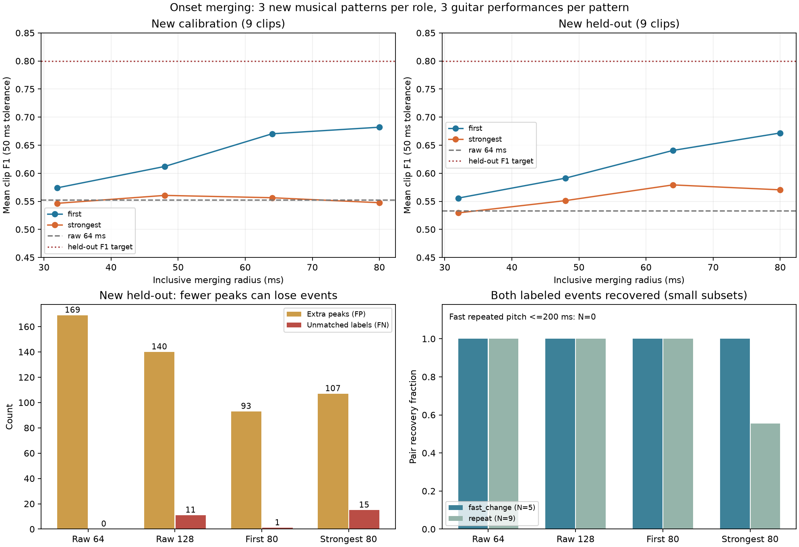

# 第七阶段：连续单音起音峰合并

已先冻结再完成校准、新留出和历史回放。**保留最早峰比保留最强峰更适合本轮数据，但单纯合并仍未达到要求；确认判决为 `insufficient_evidence`，不替换旧基线。** 128 ms / 0.8 音高候选及第六阶段结果保持不变，没有开始 Free Bird、湿声检索或新 EQ。

## 资料和冻结

从 [IDMT-SMT-Guitar 作者发布记录](https://zenodo.org/records/7544110) 新取得实际 `dataset2` 中 18 对完整普通拨奏 DI/XML，三个乐器为 Aristides 010、Fender Stratocaster、Gibson Les Paul。WAV 均为原生 44.1 kHz、24-bit、单声道，标签均为普通拾音拨弦 `PK / NO`。作者随包说明给出直接接音频接口的录音路径。原始文件与逐条来源、CRC、SHA-256 在 `assets/stage7/`，许可 CC BY-NC-ND 4.0、评价用途。[数据审计](stage7-data-idmt.md)

Lick 1–3 的三个吉他版本作校准，Lick 4–6 的三个版本作新留出，各九条录音。**每组是三个不同乐句、各三个吉他演奏，不能算九个独立曲目或九名乐手**；两组乐手均为 Christian Kehling。没有把同一乐句的其他吉他/奏法版本放到另一组。余音尾部标注允许与下个音符交叠；本轮是单声部拨弦起音序列，并不声称声音每时刻都只有一个基频。

完整压缩包未下载，公布的整包 MD5 未验证。36 个所选原件的 ZIP 长度/CRC 和本地 SHA-256 已核对，TLS 验证正常。没有按音频特征选录；选择和样本盘点只使用来源、标签、原始字节与音频头。另查的 EG-Solo 不是 DI，EGDB 的原数据访问/许可与时序质量未核实，未混入本轮。[替代来源调查](stage7-data-alternatives.md)

新方案先写 [协议](stage7-protocol.md)、[配置](../experiments/stage7.json)，完成 42 项工程测试与独立审查，再单独执行 `stage7_benchmark.py --freeze`，之后才分析真实波形。锁为 `artifacts/stage7/onsets/locked-plan.json`，SHA-256：

`7eae0c15edf768421fdd214e516b7ae83a203c96e75e94be11d5ac757a54e5a7`

锁绑定 36 个新原件、312 个历史原件、451 项历史保护文件和 17 个源码/协议摘要。保护文件包含三首原始参考 WAV、第六阶段结果与 128 ms 音高候选。首跑前发现并修复的 200 ms 数值边界问题见 [检查记录](stage7-preflight-review.md)：`4.2368→4.4368` 秒按闭区间计入快速换音，标注和匹配均按整数微秒比较。

## 检测、合并与选择

原起音分支在整条 DI 上运行：16 kHz、hop 16 ms，FFT 1024（64 ms）为原始基线 `raw64`，FFT 2048（128 ms）只作起音对照。音高分支没有重跑或更改。

- `first`：按时间保留最早峰；落在最后一个保留峰半径内的后峰被抑制。被抑制峰不能继续延长区间。
- `strongest`：按原始包络强度从高到低保留峰；等强取早峰，抑制半径内较弱峰。
- 合并半径均试 32、48、64、80 ms，包含边界。只保留原峰帧号，不造峰、不平均或移动时间点。合并只看音频峰，不看 MIDI、真起音或类别。
- 每个方法在 ±50 ms 主容差、±100 ms 诊断容差独立一对一匹配。报告全预测列表、被谁抑制、原配与重配的真事件 ID。近邻多报指未匹配峰距某个已匹配真起音不超过 50 ms，是位置代理，不能直接确定声学原因。

校准选择要求逐录音 F1 平均值（macro F1）提高、近邻多报降低，且快速换音、同音重拨、快速同音三类中，原本能找回的后音和完整音对均无损失。按 macro F1、总 FP、半径、规则类型的冻结顺序排序。**校准选中 `first_r5`，即最早峰 / 80 ms**，先写 `selected-setting.json` 并绑定校准摘要，之后才打开新留出。其他留出格只作描述，未参与改选。

## 连续录音的全部比较

以下使用 ±50 ms。校准有 141 个标注拨弦，新留出有 96 个。TP/FP/FN 分别为匹配事件、多余峰、未匹配标签。macro F1 是每条整录音的 F1 等权平均，和汇总所有事件的 micro F1 分开保存。

| 方法 / 合并半径 | 校准 TP/FP/FN | 校准 macro F1 | 新留出 TP/FP/FN | 新留出 macro F1 |
| --- | --- | --- | --- | --- |
| raw64，不合并 | 130 / 206 / 11 | 0.5526 | 96 / 169 / 0 | 0.5335 |
| raw128，起音对照 | 115 / 201 / 26 | 0.5120 | 85 / 140 / 11 | 0.5329 |
| first / 32 ms | 130 / 186 / 11 | 0.5740 | 96 / 155 / 0 | 0.5557 |
| first / 48 ms | 129 / 156 / 12 | 0.6121 | 96 / 134 / 0 | 0.5913 |
| first / 64 ms | 129 / 119 / 12 | 0.6703 | 96 / 109 / 0 | 0.6406 |
| **first / 80 ms，校准选定** | **129 / 113 / 12** | **0.6820** | **95 / 93 / 1** | **0.6717** |
| strongest / 32 ms | 123 / 193 / 18 | 0.5464 | 92 / 159 / 4 | 0.5293 |
| strongest / 48 ms | 118 / 166 / 23 | 0.5605 | 90 / 140 / 6 | 0.5513 |
| strongest / 64 ms | 107 / 139 / 34 | 0.5564 | 87 / 118 / 9 | 0.5792 |
| strongest / 80 ms | 103 / 136 / 38 | 0.5475 | 81 / 107 / 15 | 0.5704 |

选定项在新留出将总多报从 169 降为 93，减少 **76 次，约 45.0%**；近邻多报从 49 降为 1，减少约 98.0%。macro F1 提高约 0.1383，但还低于 0.80，而且新增一个严格容差下的未匹配事件。该事件不属于本轮受保护的快速或重拨子类，说明**只检查几个子类不足以保证所有原可检事件都保留**。它在校准也额外损失了一个普通事件；冻结的研究选择允许总体改善与保护子类保全，不能解释为全局无害。

128 ms 起音对照没有延续孤立音上的好成绩：在新连续留出 ±50 ms 下漏配 11 个事件；放宽到 ±100 ms 后变为 96/129/0、macro F1=0.6032。这个起音结果不改变独立的 128 ms 音高候选。

## 误删、时序偏移与真正合并须分开

新留出选定项只有一个原匹配损失，来自 `LP_Lick6_KN` 的第 3 个标签（零基 ID 2，MIDI 62）：

| 位置 | 时间 | 相对标签 |
| --- | --- | --- |
| 标注拨弦 | 2.2349 s | — |
| 原来可匹配的峰，帧 141 | 2.256 s | +21.1 ms |
| first 保留的更早峰，帧 136 | 2.176 s | −58.9 ms |

两峰相距 80 ms，较早峰抑制了原可匹配峰。保留峰在 ±50 ms 外，但在 ±100 ms 内；它没有匹配另一个真事件。因此这是**依据标签匹配定义的时序损失**，不是证据证明两次真实拨弦被合为一次。该事件与前音间隔 402.7 ms，也不是快速换音或同音重拨。

`strongest / 80 ms` 的新留出 15 个严格漏配在 ±100 ms 下全部重新匹配，变为 96/92/0、macro F1=0.6789。其常见问题是保留了较晚的强峰。例如 `AR_Lick4_KN` 一事件标签为 3.4685 s，原峰 3.456 s（−12.5 ms）被 3.520 s（+51.5 ms）抑制。原标注时序本身也有误差，故不把所有严格漏配称作物理漏拨；同时，几十毫秒代表点偏移会影响后续起音阶段分组，不能因宽容差重新匹配就视为解决。

主、诊断容差在冻结前已指定，未根据这些结果改选或平移预测。下一轮应额外约束全部原可检事件的损失，并研究用局部起音证据选代表峰，不能只选最早或最大包络峰。

## 快速换音与同音的证据量

音对按原标签相邻事件定义。快速为 IOI≤200 ms；同音指 MIDI 相同，余音是否交叠不影响这次重拨事件的计数。下面的四档边界依次为 ≤80、(80,180]、(180,200]、>200 ms。

| 角色 / 类别 | 音对 | 有样本录音 / 不同乐句 | 最短 IOI | 四档音对数 |
| --- | --- | --- | --- | --- |
| 校准 / 快速异音 | 16 | 3 / 1 | 151.1 ms | 0 / 8 / 8 / 0 |
| 新留出 / 快速异音 | 5 | 3 / 1 | 169.6 ms | 0 / 1 / 4 / 0 |
| 校准 / 同音重拨 | 12 | 3 / 1 | 283.3 ms | 0 / 0 / 0 / 12 |
| 新留出 / 同音重拨 | 9 | 6 / 2 | 226.2 ms | 0 / 0 / 0 / 9 |
| 两组 / 快速同音 | 各 0 | 各 0 / 0 | 无 | 各 0 / 0 / 0 / 0 |

选定 first / 80 ms 在新留出的快速异音后音与双端均为 5/5，同音重拨均为 9/9，没有丢失这两类原可恢复事件。但样本数少、间隔长，不能证明短间隔安全。strongest / 80 ms 的同音后音只命中 7/9，双端完整命中 5/9；相对基线丢失两个后音、四个原本完整的音对。这里的损失仍按独立匹配定义，不能自动归因为两个物理拨弦被合并。

两组都未达到各类至少 20 对的确认支持门槛，且完全没有 200 ms 内的快速同音，也没有任何 ≤80 ms 的真实相邻事件。**确认支持不足、选定项性能门槛也失败**，因此总判决为 `insufficient_evidence`、`promote=false`。不把空类别的零损失当作安全。

## 为什么合并后仍有很多峰

选定项新留出剩余 93 个未匹配峰中，38 个早于第一标签前 50 ms，9 个晚于最后标签结束后 50 ms，46 个位于两者之间；只有 1 个属于上述近邻多报。合并已经消掉大部分标注起音附近的重复，但剩余问题多为离标注较远的事件。时间位置不能证明其是底噪、碰弦还是漏标；应先复核波形与标签，再研究局部能量/周期证据，不能用真标签把录音裁干净后宣称检测改善。起音瞬间也不宜直接强制 pYIN 0.8 门槛，第六阶段最初 80 ms 的音高覆盖本就有限。

## 历史孤立音回放

新留出之后才回放旧 156 段单音。两种原始窗共 312 组峰数组与第六阶段逐项一致；整数微秒匹配相对旧浮点评分的 TP/FP/FN 差均为 0，没有覆盖旧结果。下表为汇总事件的 **micro F1**，与第六阶段的 F1 口径相同，不与上面的 macro F1 混用。

| 历史组 / 方法 | TP/FP/FN | micro F1 |
| --- | --- | --- |
| Ibanez / raw64 | 78 / 52 / 0 | 0.7500 |
| Ibanez / first 80 ms | 78 / 10 / 0 | 0.9398 |
| Fender / raw64 | 78 / 66 / 0 | 0.7027 |
| Fender / first 80 ms | 77 / 8 / 1 | 0.9448 |
| Fender / strongest 80 ms | 78 / 7 / 0 | 0.9571 |

已知重复峰确实大幅减少，但 first 在一个旧 Fender 单音也损失严格匹配。这些旧数据已被观察，strongest 在此更好也不能反过来替换新校准选择，更不能充作新确认。

## 工程验证与交付

- 新增 `onset_merging.py`、`stage7_benchmark.py`、`prepare_stage7_di.py`；`stage7_analyze.py` 只从完成结果导出表、图、标签支持与后验位置诊断，不跑音频或改选。没有新增依赖，没有修改旧前端或生产评分。
- 全回归 **232 passed，0 失败/错误/跳过**。新增 42 项工程检查覆盖整数边界、第一峰非传递合并、最强峰同强规则、重匹配恢复、峰归属、静音分母、选择/支持门槛和配置约束。XML 为 `artifacts/stage7/pytest.xml`。
- 独立重算 80 项分组汇总、3480 项逐录音评分和损失归因；另用独立动态规划核查最大匹配数及受保护事件、音对，全部一致。36 个新原件、312 个历史原件、451 个历史保护与 17 个冻结来源摘要一致。
- 主结果、校准和先行选择在 `artifacts/stage7/onsets/`；完整 80 行汇总为 `method-grid.csv`，后验分析为 `artifacts/stage7/analysis.json`，图已检查可读性。已完成运行拒绝覆盖。

下一步需要补足真正短间隔的重复拨弦，并针对代表峰选择与非近邻误报设计新实验。已给出 [六条 DI 补录单](stage7-recording-spec.md)：三条校准、三条新确认，100/125/约167 ms 换音和同音重拨，含慢速对照，每角色计划 27 个快速异音对和 27 个快速同音对；可选增加 75 ms 档。需要按实际波形标记起音，不能把节拍器格点当真值。新实验仍须重新冻结，当前新留出以后只算开发资料。

本轮不支持湿声、复音或超快重拨的通用安全结论，也未验证力度分离、音色检索或部署。Free Bird 匹配继续暂停。
